# Diagrams

Diagrams for AmarEcommerce, written in Mermaid so they render on GitHub and in most editors. Keep them in step with the code: update the ERD when a migration changes, the class diagrams when a model relation or service dependency changes, and the sequences when a flow changes. Prose explanations live in [TECHNICAL.md](TECHNICAL.md).

1. [Entity relationship diagram](#1-entity-relationship-diagram)
2. [Class diagrams](#2-class-diagrams)
3. [Sequence diagrams](#3-sequence-diagrams)

## 1. Entity relationship diagram

Every application table. Laravel infrastructure tables (`cache`, `sessions`, `jobs`, `password_reset_tokens`) are left out. Money columns are unsigned integers in whole currency units. Dashed lines are polymorphic (morph) links.

```mermaid
erDiagram
    users {
        bigint id PK
        string name
        string email UK
        string status "UserStatusEnum"
        timestamp email_verified_at
        string password
        string google_id
        string facebook_id
        string phone UK
        text shipping_address
        text billing_address
        timestamp deleted_at
    }
    roles {
        bigint id PK
        string name UK "fixed key, UserRoleEnum for built-ins"
        string label "editable display name"
        string guard_name
    }
    permissions {
        bigint id PK
        string name UK "PermissionEnum value"
        string guard_name
    }
    model_has_roles {
        bigint role_id FK
        string model_type
        bigint model_id
    }
    model_has_permissions {
        bigint permission_id FK
        string model_type
        bigint model_id
    }
    role_has_permissions {
        bigint permission_id FK
        bigint role_id FK
    }
    staff_profiles {
        bigint id PK
        bigint user_id FK, UK
        string compensation_type "StaffCompensationTypeEnum"
        int compensation_value
        date joined_at
        date left_at
    }
    staff_payments {
        bigint id PK
        bigint user_id FK
        int amount
        tinyint period_month
        smallint period_year
        int total_sales_snapshot
        string compensation_type_snapshot
        int compensation_value_snapshot
        timestamp paid_at
        bigint paid_by FK
    }
    categories {
        bigint id PK
        bigint parent_id FK
        tinyint depth
        string name
        string slug UK
        string status "CategoryStatusEnum"
        int sort_order
        bool is_featured
        bigint updated_by FK
        timestamp deleted_at
    }
    products {
        bigint id PK
        bigint category_id FK
        string sku UK
        string name
        string slug UK
        int price
        tinyint discount_percentage
        int quantity
        string status "ProductStatusEnum"
        string badge "ProductBadgeEnum"
        bool is_featured
        string type "child type name, null for plain products"
        bigint updated_by FK
        timestamp deleted_at
    }
    ai_assistant_embeddings {
        bigint id PK
        string embeddable_type "morph, UK with id"
        bigint embeddable_id
        string model
        string content_hash
        json vector "unit length"
    }
    media {
        bigint id PK
        string model_type
        bigint model_id
        string collection_name "images, image, avatar, logo, icon, favicon"
        int order_column "gallery order, first is the thumbnail"
        string file_name
        string disk
        json generated_conversions
    }
    banners {
        bigint id PK
        string title
        string subtitle
        bool show_text
        string link
        int sort_order
        string status "BannerStatusEnum: active, inactive"
        timestamp starts_at
        timestamp ends_at
        bigint updated_by FK
    }
    offers {
        bigint id PK
        string name
        string headline "big line of the home page offer banner"
        string type "OfferTypeEnum: global, specific"
        tinyint discount_percentage
        bool is_active
        timestamp starts_at
        timestamp ends_at
        bigint updated_by FK
    }
    offerables {
        bigint offer_id PK, FK
        string offerable_type PK
        bigint offerable_id PK
    }
    orders {
        bigint id PK
        string public_order_id UK
        bigint user_id FK
        string customer_name
        string customer_email
        int subtotal
        int discount_amount
        json applied_offers
        int extra_discount_percentage
        int extra_discount_amount
        int total
        string status "OrderStatusEnum"
        string payment_status "PaymentStatusEnum"
        string payment_method "PaymentMethodEnum"
        string transaction_id
        string contact_mode "ContactModeEnum"
        string phone
        text shipping_address
        text billing_address
        timestamp completed_at
        bigint completed_by FK
        bigint updated_by FK
    }
    order_items {
        bigint id PK
        bigint order_id FK
        bigint product_id FK
        string product_name_snapshot
        string sku_snapshot
        int quantity
        int unit_price
        tinyint discount_percentage
        string offer_name_snapshot
        tinyint offer_discount_percentage
        int line_total
    }
    faqs {
        bigint id PK
        string title
        text description
        string status "FaqStatusEnum"
        bigint updated_by FK
    }
    system_settings {
        bigint id PK
        boolean maintenance_enabled
        timestamp maintenance_starts_at
        timestamp maintenance_ends_at
        string maintenance_secret
    }
    notifications {
        uuid id PK
        string type "NotificationTypeEnum"
        string notifiable_type
        bigint notifiable_id
        text data "message, params, route"
        timestamp read_at
    }

    roles ||--o{ model_has_roles : "assigned via"
    users ||..o{ model_has_roles : "has role"
    permissions ||--o{ model_has_permissions : "granted via"
    users ||..o{ model_has_permissions : "extra permissions"
    roles ||--o{ role_has_permissions : "default permissions"
    permissions ||--o{ role_has_permissions : "belongs to role"

    users ||--o| staff_profiles : "staff details"
    users ||--o{ staff_payments : "is paid"
    users ||--o{ staff_payments : "pays (paid_by)"

    categories ||--o{ categories : "parent of"
    categories ||--o{ products : contains
    products ||..o| ai_assistant_embeddings : "AI search vector (morph)"
    products ||..o{ media : "images (up to 5, ordered)"
    banners ||..o{ media : image
    categories ||..o{ media : image
    users ||..o{ media : avatar

    offers ||--o{ offerables : targets
    categories ||..o{ offerables : "targeted by"

    users ||--o{ orders : places
    orders ||--o{ order_items : contains
    products ||--o{ order_items : "sold as"
    users ||--o{ orders : "completes (completed_by)"


    users ||..o{ notifications : receives

    users ||--o{ categories : "last updated"
    users ||--o{ products : "last updated"
    users ||--o{ banners : "last updated"
    users ||--o{ offers : "last updated"
    users ||--o{ faqs : "last updated"
    users ||--o{ orders : "last updated"
```

## 2. Class diagrams

### Domain models

Eloquent models with their relations, traits and the domain methods other code relies on. Casts to enums are shown as attribute types.

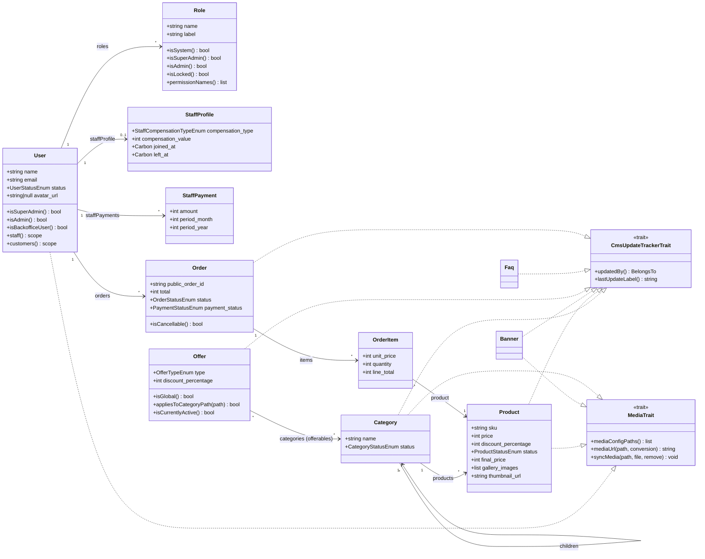

### Services

Services own the business logic. Arrows show constructor dependencies. Livewire components and controllers call these services and never touch models directly.

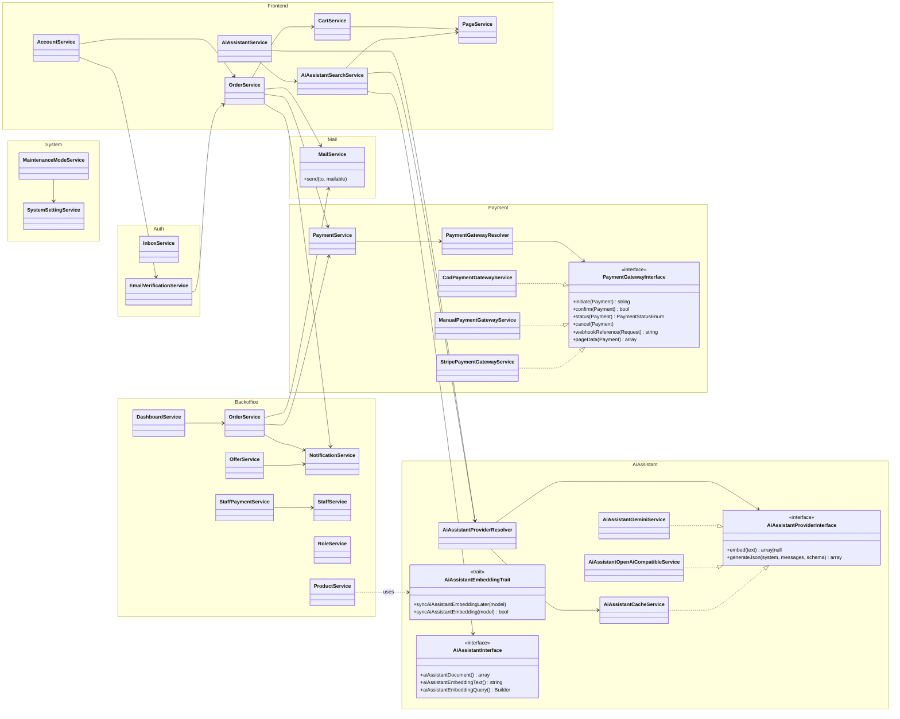

## 3. Sequence diagrams

### Request during maintenance

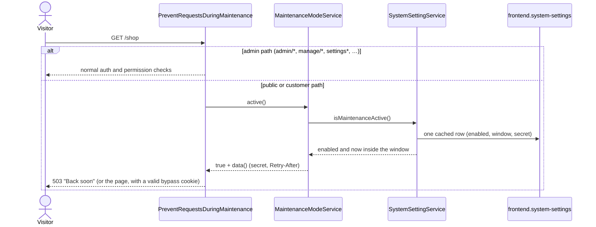

### Checkout and payment

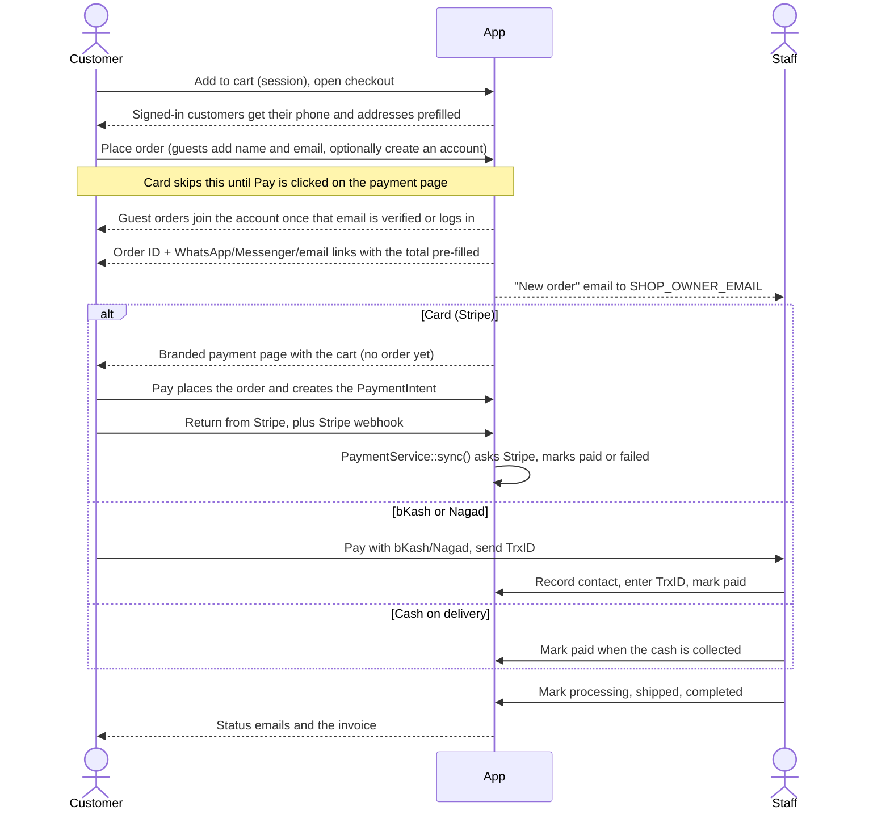

### Order status

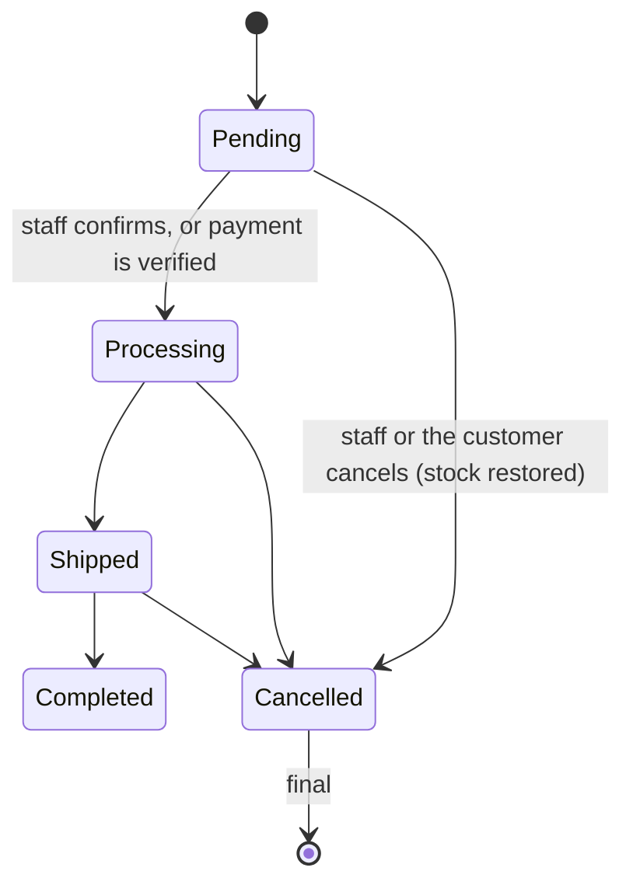

### Staff updates an order

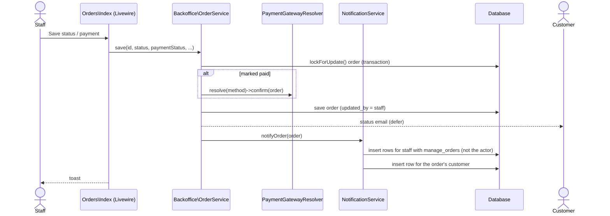

### Publishing an offer

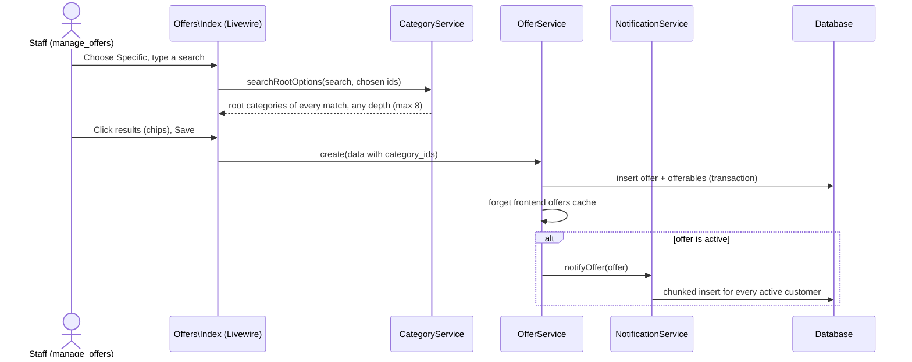

### Opening a notification

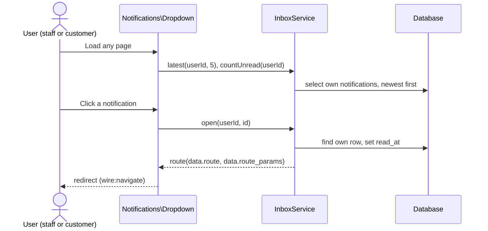

### Uploading an avatar

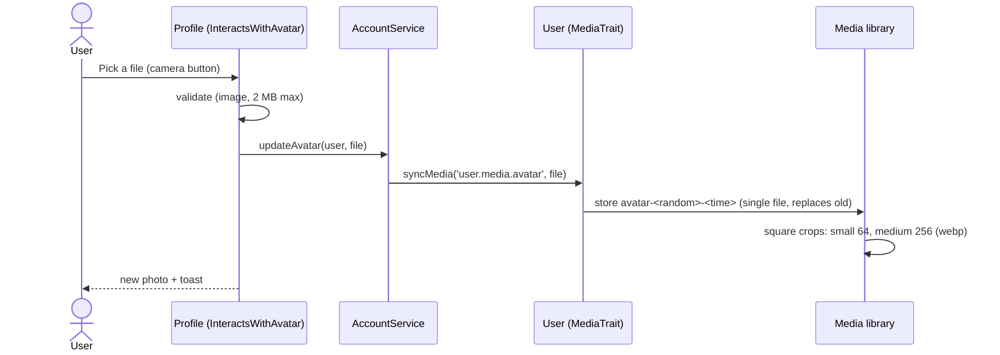

### AI assistant suggestions (RAG)

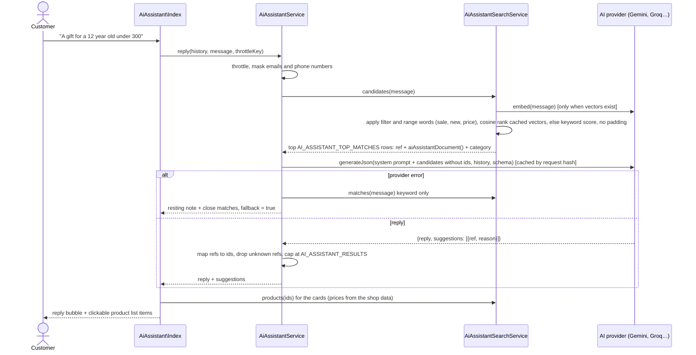

Product writes in `ProductService` call `syncAiAssistantEmbeddingLater()` from `AiAssistantEmbeddingTrait`, which embeds after the response. It re-embeds only when the text hash or the embedding model changed. `php artisan ai-assistant:embed` backfills every model listed in `ai-assistant.models`.
