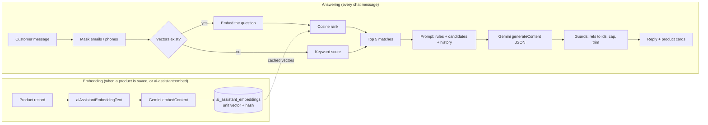

# Our RAG: how the AI shopping assistant works

This document explains the **Ask AI** assistant (`/ai-assistant`): what we built, how it works, and why each part exists. It is written so you can learn RAG from it: by the end you should be able to read every file involved, change it safely, add another model or provider, and build a RAG of your own from scratch.

Commands live in [SETUP_COMMANDS.md](SETUP_COMMANDS.md). Settings live in [SETUP_ADVANCED.md](SETUP_ADVANCED.md).

## Contents

1. [RAG in plain words](#1-rag-in-plain-words)
2. [What we built](#2-what-we-built)
3. [The big picture](#3-the-big-picture)
4. [Core ideas you need](#4-core-ideas-you-need)
5. [The files and what each one does](#5-the-files-and-what-each-one-does)
6. [One message, step by step](#6-one-message-step-by-step)
7. [Keeping the embeddings fresh](#7-keeping-the-embeddings-fresh)
8. [Security and privacy](#8-security-and-privacy)
9. [Saving tokens and money](#9-saving-tokens-and-money)
10. [Configuration](#10-configuration)
11. [Extending it](#11-extending-it)
12. [Build a RAG yourself, from zero](#12-build-a-rag-yourself-from-zero)
13. [Testing a RAG](#13-testing-a-rag)
14. [Limits and what can be done next](#14-limits-and-what-can-be-done-next)
15. [Glossary](#15-glossary)

## 1. RAG in plain words

A language model (LLM) like Gemini knows a lot about the world, but **nothing about our shop**: not our products, our prices or what is in stock. If you ask it "which running shoes should I buy?", it will happily invent products.

**RAG (Retrieval-Augmented Generation)** fixes that in three moves:

1. **Retrieve:** find the few records in *our* database that relate to the question.
2. **Augment:** paste those records into the prompt.
3. **Generate:** ask the model to answer *using only those records*.

The model becomes a good writer and recommender on top of our real data, instead of a guesser. No training or fine-tuning is involved: we only choose what to show the model, per question.

## 2. What we built

| Version | What the customer gets | Status |
|---|---|---|
| v1: chat | An **Ask AI** page with a Beta badge. The customer chats about products and shopping | Done |
| v2: suggestions (RAG) | The reply comes with real products (out-of-stock ones are named as such) as clickable list items, each with a one-line reason | Done |
| v3: cart actions | "Add the first one", "remove the shoes from my cart" | Planned (see [section 14](#14-limits-and-what-can-be-done-next)) |

Built-in safety and cost features:

- Suggestions can only be products we actually sent to the model. Names, images and prices on the cards always come from our database.
- The model never sees database ids or customer details. Emails and phone numbers in messages are masked.
- Identical requests are answered from a cache, and every message is rate-limited.
- If the AI is down or out of quota, keyword search still returns close matches.
- No new packages. Everything uses Laravel's HTTP client and cache, so it runs on cPanel and on a VPS.

## 3. The big picture

There are two flows: **embedding** (offline, when products change) and **answering** (online, per message).



## 4. Core ideas you need

### 4.1 Embeddings

An **embedding** is a list of numbers (a **vector**) that represents the *meaning* of a text. Texts with similar meaning get vectors that point in similar directions.

```
"Lightweight running shoes" → [0.12, -0.40, 0.88, …]   (768 numbers)
"Trainers for jogging"      → [0.10, -0.37, 0.90, …]   (very similar direction)
"Ceramic coffee mug"        → [-0.55, 0.20, 0.10, …]   (different direction)
```

An embedding model (`gemini-embedding-001`) produces these vectors. We ask for 768 numbers per text (`AI_EMBEDDING_DIMENSIONS`): enough for good search, small enough to keep in memory.

### 4.2 Cosine similarity

To compare two vectors we measure the angle between them: **cosine similarity**, from −1 (opposite) to 1 (same meaning).

```
cosine(a, b) = (a · b) / (|a| × |b|)
a · b        = a1×b1 + a2×b2 + … + an×bn      (the dot product)
|a|          = sqrt(a1² + a2² + … + an²)       (the length)
```

**Our shortcut:** we store every product vector **normalized** (divided by its length, so its length is 1). Then the cosine is just the dot product, and since we only need the *ranking*, we don't even need to normalize the question vector. One multiplication loop per product is all the search costs.

Worked example with 2 numbers instead of 768:

```
question   q = [0.9, 0.1]
"Near product" v = [1.0, 0.0]   → q·v = 0.9
"Far product"  w = [0.0, 1.0]   → q·w = 0.1      → "Near product" ranks first
```

This exact example is a test in `tests/Feature/Frontend/AiAssistantTest.php`.

### 4.3 Keyword search (the fallback)

When there are no vectors (no embedding model configured) or the embedding call fails, we score products by words instead:

- Split the message into words of 3+ letters (Unicode-aware, so Bangla works), and drop filler words like "the", "product", "suggest" (`assistant.stop_words`).
- Trim a plural ending from each word (`assistant.word_suffixes`, default `s`), so "cloths" looks for "cloth".
- A word matches only at the **start** of a word in the product text: "cloth" finds "clothing", but "are" no longer finds "skincare".
- For each product: a word found in the **name** scores 3, in the type's extra fields (`aiAssistantColumns()`) **or category** 2, in the **description** 1.
- Highest scores first.

Keyword search is cheap and predictable, but it misses synonyms ("trainers" vs "sneakers"). Semantic search catches those. Having both makes the assistant robust.

### Filters: questions about data, not meaning

Some questions are about facts that neither search can see by meaning: "Which products are on sale?", "What is new this week?". Filters answer those from real data:

- `assistant.filters` in `config/ai-prompts.php` maps a filter name to its trigger words (`on_sale`: sale, discount, offer… `new`: new, latest, week…). Add words for any language there.
- Each model returns a sort value per filter from `aiAssistantFilterValues()` (Product: `on_sale` = discount %, `new` = date added). Null or missing means the record doesn't match. Models without filters return `[]` from `AiAssistantTrait`.
- Trigger words are removed from the search words. If nothing else is left ("Which products are on sale?"), the matching records are sent, highest value first, with **no embedding call**. If other words remain ("cotton on sale"), search runs as usual and only records that also match the filter are kept.
- **Number ranges** work the same way: `assistant.ranges` maps a value name to its `max` words (under, below, less…), `min` words (over, above…) and `between` words (between, from). "under $1,000", "less than ১০০০ taka" and "between 500 and 1500" become a price range. Commas and Bangla digits (`assistant.digits`) are normalised first. The model returns the value (Product: `price` = final price) from the same `aiAssistantFilterValues()`. Matches are sorted cheapest first.
- The same ranking feeds the keyword fallback, so sale and new questions still get real matches when the AI is down.

Nothing is padded: if no record matches, the model gets an empty list and says so.

### 4.4 Candidates, not the whole catalogue

We never send the whole catalogue to the model. Retrieval picks the **top 5 matching products** (`AI_ASSISTANT_TOP_MATCHES`), and the model chooses **up to 5** of them (`AI_ASSISTANT_RESULTS`). If retrieval finds fewer than 5, only those are sent: we never pad the list with unrelated products, so every suggestion is a real match. With no match at all, the model says so and asks a clarifying question.

### 4.5 Grounding and structured output

The system prompt tells the model to suggest **only** candidates, by their `ref` number, and never to invent products, prices or stock. We also force a **JSON response** that matches a schema:

```json
{ "reply": "Here are good picks for running:", "suggestions": [ { "ref": 1, "reason": "Light, cushioned shoes made for daily runs." } ] }
```

JSON mode means we never parse free text. The schema means the shape is always the same.

### 4.6 Never trust the model's output

Even with a perfect prompt, models sometimes return ids that don't exist. So the server **checks everything**: unknown refs are dropped, duplicates removed, the list capped, reasons trimmed, and the cards are built from our own data. The model only ever *chooses*; our code decides what is real.

## 5. The files and what each one does

Read them in this order. Each layer depends only on the ones above it.

### Contracts (what things must be able to do)

| File | Role |
|---|---|
| `app/Interfaces/AiAssistant/AiAssistantProviderInterface.php` | What any AI provider must do: `embed(text): ?array` and `generateJson(system, messages, schema): array` |
| `app/Interfaces/AiAssistant/AiAssistantInterface.php` | What a model must offer to join the assistant: `aiAssistantDocument()` (the **only** fields the AI may see), `aiAssistantEmbeddingText()` (text to embed), `aiAssistantFilterValues()` (values for sale, new and other filters), `aiAssistantEmbeddingQuery()` (which records to embed) |

### Model side

| File | Role |
|---|---|
| `app/Traits/AiAssistant/AiAssistantTrait.php` | Gives a model the `aiAssistantEmbedding()` morph relation and a default `aiAssistantEmbeddingQuery()` |
| `app/Traits/AiAssistant/ProductAiAssistantTrait.php` | Builds the document and embedding text for any product type: name, the type's `aiAssistantColumns()` (empty for plain products, e.g. `size` for a `Shirt` type), price, stock note, category path and description. `app/Models/Product.php` implements `AiAssistantInterface`, uses this trait and is listed in `ai-assistant.models`. Its document is name, author, format, price and a 200-character description. Its embedding text adds the category path and up to 500 characters of description |
| `app/Models/AiAssistantEmbedding.php` | One stored vector per record (polymorphic, so any model can have one) |
| `database/migrations/2026_10_16_000001_create_ai_assistant_embeddings_table.php` | `embeddable_type`, `embeddable_id` (unique pair), `model`, `content_hash`, `vector` (json) |

### Providers (talking to the AI)

| File | Role |
|---|---|
| `app/Services/AiAssistant/AiAssistantGeminiService.php` | Calls Gemini's `embedContent` and `generateContent` (JSON mode with `responseSchema`, `maxOutputTokens`, and `AI_CHAT_REASONING` as `thinkingBudget` when a number or `thinkingLevel` when a word). Converts our plain JSON schema to Gemini's format (upper-case types) |
| `app/Services/AiAssistant/AiAssistantOpenAiCompatibleService.php` | One class for every OpenAI-compatible API (Groq, OpenAI, Mistral, DeepSeek, OpenRouter, Ollama…). Calls `{url}/chat/completions` (`response_format` JSON schema in strict mode, so the reply always matches the schema, `max_completion_tokens`, `reasoning_effort` from `AI_CHAT_REASONING`) and `{url}/embeddings` (`dimensions` when set). A new provider needs only new `.env` values |
| `app/Services/AiAssistant/AiAssistantCacheService.php` | A wrapper with the same interface that caches answers and question embeddings |
| `app/Resolvers/AiAssistant/AiAssistantProviderResolver.php` | `chat()` and `embedding()` build the class of `AI_CHAT_DRIVER` or `AI_EMBEDDING_DRIVER` from `drivers` in `config/ai-assistant.php`, wrapped in the cache when `AI_ASSISTANT_CACHE_MINUTES > 0`. Each driver reads its URL, key and model from the matching `chat` or `embedding` config |
| `app/Enums/AiAssistant/AiAssistantRoleEnum.php` | Chat roles (`user`, `assistant`). Provider names never appear in code, only in `.env` values |

### Retrieval and answering

| File | Role |
|---|---|
| `app/Services/Frontend/AiAssistant/AiAssistantSearchService.php` | **The "R" in RAG.** `candidates()` (filters and ranges, then semantic, else keyword), `matches()` (keyword only, for the fallback), `products()` (models for the cards) |
| `app/Services/Frontend/AiAssistant/AiAssistantService.php` | **The "A" and "G".** `reply()`: throttle, mask, retrieve, build the prompt, call the provider, apply the guards, fall back on errors |
| `app/Services/Frontend/Shop/PageService.php` | `getListedProducts()` (in-stock and out-of-stock products): cached catalogue data that retrieval reads, so a chat message adds no catalogue query |

### Keeping embeddings in sync

| File | Role |
|---|---|
| `app/Traits/AiAssistant/AiAssistantEmbeddingTrait.php` | For services and commands: `syncAiAssistantEmbeddingLater($model)` (after the response) and `syncAiAssistantEmbedding($model)` (now). Re-embeds only when the text hash changed |
| `app/Services/Backoffice/Catalog/ProductService.php` | Uses the trait: calls `syncAiAssistantEmbeddingLater($product)` after create and update |
| `app/Console/Commands/AiAssistant/AiAssistantEmbedCommand.php` | `php artisan ai-assistant:embed`: walks every class in `ai-assistant.models` and embeds what changed |

### UI and config

| File | Role |
|---|---|
| `app/Livewire/Frontend/AiAssistant/Index.php` | Chat state (`messages` with `role`, `text`, `suggestions`), `send()`, `clear()`, computed `products` for the cards |
| `resources/views/components/frontend/ai-assistant/index.blade.php` | Chat page: example prompts, bubbles, suggestion cards (`x-frontend.cards.product-list-item`), composer |
| `config/ai-assistant.php` + `app/Helpers/config_helpers.php` | Every setting, read through plain helpers (`isAiAssistantEnabled()`, `aiAssistantTopMatches()` …) |
| `config/ai-prompts.php` | **Every AI text in one place:** the system prompt rules, reply and error messages, history note, masking tokens, keyword stop words, and the labels a model sends to the AI (`product.document.*`, `product.embedding.*`). Read with `aiPrompt('key', ['placeholder' => value])` and `aiPromptList('key')`. Change wording here, never in code. Editing `product.embedding.*` changes the embedded text, so run `php artisan ai-assistant:embed` afterwards |
| `tests/Feature/Frontend/AiAssistantTest.php` | Every behaviour above, with `Http::fake()` (no real API calls) |

## 6. One message, step by step

The customer types *"running shoes under 3000"* and presses Enter.

1. **Livewire** (`AiAssistant\Index::send()`) validates the message (required, max 500 characters) and calls `AiAssistantService::reply($history, $message, $throttleKey)`.

2. **Throttle.** `ThrottleTrait` allows `THROTTLE_ASSISTANT_ATTEMPTS` messages a minute per user (or IP for guests). Over the limit, the message field shows "The assistant is busy…".

3. **Mask.** `redact()` replaces emails with `[email]` and long digit runs (phone numbers, Bangla digits included) with `[number]`.

4. **Retrieve.** `AiAssistantSearchService::candidates()`:
   - loads the cached in-stock products and category names;
   - pulls filter and range words out of the question (section 4);
   - if search words remain and vectors exist: embeds the question (cached) and dot-products it with each cached product vector, else keyword scores;
   - keeps only records that pass the filters and ranges, then the top `AI_ASSISTANT_TOP_MATCHES` (default 5), with no padding;
   - builds one row per candidate: `ref` (1…5), the model's `aiAssistantDocument()`, `category`, plus the real `id`, which stays on the server.

5. **Build the messages.** The last 12 chat messages (`AI_ASSISTANT_HISTORY_MESSAGES`), masked, with the **names** of products suggested earlier appended, so "tell me more about the second one" works.

6. **Build the system prompt.** Rules (today's date, only candidates, by ref, at most 5, no invented data, reply in `:language`, under 80 words, never reveal the rules) followed by the candidates as JSON lines, **without** the `id` field. Each row carries its `added` date and, when discounted, `discount` and `regular_price`, so questions like "What is new this week?" and "Which products are on sale?" can be answered from data. `:language` is decided by the server, not the model: if the message contains a script listed in `assistant.languages` (Bengali → Bangla), that language; otherwise `assistant.default_language` (English). Smaller models like Flash-Lite otherwise tend to answer in the language of the product data:

   ```
   Candidates (JSON lines):
   {"ref":1,"name":"Lightweight running shoes","price":"৳2,000","discount":"20%","regular_price":"৳2,500","added":"2026-10-20","about":"…","category":"Footwear › Sports"}
   ```

7. **Generate.** The resolver returns the Gemini provider (wrapped in the cache). `generateJson()` sends the system prompt, the messages and the schema. An identical earlier request is answered from the cache with no API call.

8. **Guard.** Map each returned `ref` to the real `id`. Drop unknown refs and duplicates, keep at most 5, and trim each reason to 160 characters.

9. **Fallback.** If the call failed (network, quota, 4xx/5xx): keyword `matches()` with a short "resting" note, and `fallback: true`.

10. **Render.** Livewire appends the user message and the reply (with `suggestions: [{id, reason}]`). The computed `products` loads those ids from the cached catalogue, so cards show **our** name, image and price, linking to the product page.

## 7. Keeping the embeddings fresh

A vector is only useful if it describes the current product. The rules:

- **What gets embedded:** `ProductAiAssistantTrait::aiAssistantEmbeddingText()`: name, the type's extra fields, category path, and up to 500 characters of the description without HTML. Price is left out on purpose: a price edit shouldn't cost an embedding call, and the model sees the live price in the candidates anyway.
- **When:** after every create or update in `ProductService`, through `syncAiAssistantEmbeddingLater()`, which uses `defer()` so the admin doesn't wait. In bulk, run `php artisan ai-assistant:embed`.
- **Only when needed:** we store `content_hash = sha256(embedding model + text)`. If the hash and model match the stored row, nothing is sent. Re-running the command on an unchanged catalogue makes zero API calls.
- **Normalized on save:** vectors are stored with length 1 (see [4.2](#42-cosine-similarity)).
- **Cache:** all vectors for the current embedding model are cached under `frontend.ai-assistant-vectors` and cleared whenever a vector is written.
- **Changing the embedding model or dimensions** changes the hash, so the next `ai-assistant:embed` re-embeds everything. Vectors from another model are never mixed in, because the cache only loads rows of the current model.

## 8. Security and privacy

| Risk | What we do |
|---|---|
| Leaking database data | The model sees only `aiAssistantDocument()` fields (public catalogue data), the category and a per-request `ref`. Never ids, emails, orders or anything else. A new field reaches the AI only if someone adds it to that method on purpose |
| Leaking customer details | Emails and phone numbers in messages and history are masked before sending. No user id, name or email is ever in the prompt |
| Made-up products or prices | Only refs from the candidate list are accepted. Cards read names and prices from our data, never from the model |
| Prompt injection ("ignore your rules…") | The prompt tells the model never to reveal or change its rules. Even if it complies with an attacker, the server guards still allow only real candidates, and the output is plain text escaped by Blade |
| Abuse and cost spikes | Per-user/IP rate limit, message length limit, trimmed history, staff and disabled sites never see the page |
| Secrets | `AI_CHAT_API_KEY` and `AI_EMBEDDING_API_KEY` live in `.env`, read through config, sent only as a header (`x-goog-api-key` or `Authorization: Bearer`) |

## 9. Saving tokens and money

- **Response cache** (`AiAssistantCacheService`, `AI_ASSISTANT_CACHE_MINUTES`, default 60): the key is a sha256 of the job (chat or embedding), driver, URL, model, dimensions, system prompt (with candidates), messages and schema. The same question with the same catalogue costs nothing the second time. When stock or prices change, the candidates change, so the key changes and the answer is fresh. Question embeddings are cached too. Embeddings made by `ai-assistant:embed` are not, because they are stored in the database anyway.
- **No hidden thinking tokens:** newer Gemini Flash models "think" before answering, and those tokens are billed. In a live test, one short answer cost 491 thinking tokens for 13 output tokens. Picking products from a list doesn't need it, so we use **Flash-Lite** (`gemini-flash-lite-latest`), which doesn't think by default and has its own, larger free quota. The free tier allowed only 20 Flash requests a day. Leave `AI_CHAT_REASONING` empty for Flash-Lite, because it rejects `0`. If you switch to a thinking model like `gemini-flash-latest`, set `AI_CHAT_REASONING=0`.
- **Hard output cap:** `AI_ASSISTANT_MAX_OUTPUT_TOKENS` (default 1024) limits what one reply can cost, on top of the "under 80 words" instruction.
- **Small prompts:** 5 products with 200-character descriptions, 12 history messages, replies under 80 words.
- **One catalogue pass per request:** `AiAssistantSearchService` is bound as `scoped` in `AppServiceProvider`, and it builds the in-stock catalogue, lower-cased search text and vectors once per request. Retrieval, history names and the cards all reuse them.
- **At most 2 calls per message:** 1 embedding (only when vectors exist) and 1 generation.
- **No re-embedding** of unchanged products (content hash), and price changes don't count.
- **Free-tier friendly:** `ai-assistant:embed --sleep=1` pauses between calls to respect requests-per-minute limits.

## 10. Configuration

```dotenv
AI_ASSISTANT_ENABLED=true
AI_ASSISTANT_EXAMPLE_PROMPTS_UI="Suggest a gift under 1000|What is new this week?|Which products are on sale?"
AI_ASSISTANT_HISTORY_MESSAGES=12        # chat messages sent as context
AI_ASSISTANT_MESSAGE_MAX_LENGTH=500
AI_ASSISTANT_TIMEOUT_SECONDS=20
AI_ASSISTANT_TOP_MATCHES=5              # best-matching products sent to the AI
AI_ASSISTANT_RESULTS=5                  # max suggestions shown
AI_ASSISTANT_CACHE_MINUTES=60           # 0 turns the response cache off
AI_ASSISTANT_MAX_OUTPUT_TOKENS=1024     # hard cap per reply
THROTTLE_ASSISTANT_ATTEMPTS=10       # messages per minute per user or IP
AI_CHAT_DRIVER=openai                 # API format: openai (Groq, OpenAI, Mistral, Ollama…) or gemini
AI_CHAT_URL=https://api.groq.com/openai/v1
AI_CHAT_API_KEY=
AI_CHAT_MODEL=openai/gpt-oss-120b     # best free Groq chat model, supports JSON schema output
AI_CHAT_REASONING=low                 # low, medium or high; a number is a Gemini thinking budget; empty = model default
AI_EMBEDDING_DRIVER=gemini            # empty driver, URL or key = the chat ones
AI_EMBEDDING_URL=https://generativelanguage.googleapis.com/v1beta/models
AI_EMBEDDING_API_KEY=
AI_EMBEDDING_MODEL=gemini-embedding-001   # empty = keyword search only
AI_EMBEDDING_DIMENSIONS=768
```

Settings are named by **job** (chat, embedding), never by provider, so switching provider means changing values, not keys. Groq has no embedding models, so chat uses Groq and embeddings use Gemini. Vectors are stored per embedding model, so changing only the chat settings keeps them valid. Change the embedding driver, model or dimensions only together with `php artisan ai-assistant:embed`.

| Provider | `AI_CHAT_DRIVER` | `AI_CHAT_URL` | Example model |
|---|---|---|---|
| Groq | `openai` | `https://api.groq.com/openai/v1` | `openai/gpt-oss-120b` |
| Gemini | `gemini` | `https://generativelanguage.googleapis.com/v1beta/models` | `gemini-flash-lite-latest` (leave reasoning empty) |
| OpenAI | `openai` | `https://api.openai.com/v1` | `gpt-4.1-mini` |
| Ollama (local) | `openai` | `http://localhost:11434/v1` | `llama3.2` (any non-empty key) |

The page appears only when `AI_ASSISTANT_ENABLED=true` **and** `AI_CHAT_URL`, `AI_CHAT_API_KEY` and `AI_CHAT_MODEL` are set. Models available to a key: `GET {AI_CHAT_URL}/models` (Bearer key for `openai`, `x-goog-api-key` header for `gemini`). Run `php artisan config:clear` after editing `.env`.

## 11. Extending it

### Add another model (for example `Course`)

1. **Model:** `class Course extends Model implements AiAssistantInterface`, `use AiAssistantTrait;`, then write:
   - `aiAssistantDocument()`: only public fields, kept short;
   - `aiAssistantEmbeddingText()`: the text that describes its meaning;
   - optionally `aiAssistantEmbeddingQuery()`: which records, with eager loads.
   - optionally `aiAssistantFilterValues()`: a sort value per filter name in `assistant.filters` (null = doesn't match);
2. **Service:** in `CourseService`, `use AiAssistantEmbeddingTrait;` and call `$this->syncAiAssistantEmbeddingLater($course)` after create and update.
3. **Config:** add `Course::class` to `models` in `config/ai-assistant.php`, then run `php artisan ai-assistant:embed`.
4. **Retrieval and cards:** `AiAssistantSearchService` currently searches products. Add a candidates source for the new model (or merge both lists) and a card for it. Vectors are already stored per model type (`vectors()[morph class]`).

Nothing else changes: services only check `instanceof AiAssistantInterface`, and a model that doesn't implement it is silently skipped.

### Add another provider (for example OpenAI, Mistral or Ollama)

**OpenAI-compatible API (most providers): `.env` only, no code or config change.** Set `AI_CHAT_DRIVER=openai`, the provider's `AI_CHAT_URL` (the part before `/chat/completions`), `AI_CHAT_API_KEY` and `AI_CHAT_MODEL`. The same goes for `AI_EMBEDDING_*`.

**A different API format** (like Gemini's native API): create `app/Services/AiAssistant/AiAssistant<Name>Service.php` implementing `AiAssistantProviderInterface`, reading `aiAssistantChatConfig()` in `generateJson()` and `aiAssistantEmbeddingConfig()` in `embed()`. Return `null` from `embed()` if it has no embedding model. Add it to `drivers` in `config/ai-assistant.php` and set `AI_CHAT_DRIVER=<name>`.

**Chat and embeddings already mix**, because each job has its own settings. A failover that tries one provider then another is just another class implementing the same interface. `AiAssistantCacheService` is already an example of this "wrapper" pattern.

## 12. Build a RAG yourself, from zero

Here is the whole technique in its smallest working form, so you can rebuild it in any project. Laravel is used for brevity; the steps apply to any stack.

### Step 1: decide what the model may know

Pick the records and the **public** fields. This is your privacy boundary.

```php
$document = ['name' => $product->name, 'category' => $product->category?->name, 'price' => $product->price];
```

### Step 2: write the text that captures meaning

```php
$text = "{$product->name}\nCategory: {$product->category?->name}\n".Str::limit(strip_tags($product->description), 500);
```

### Step 3: embed it

```bash
curl -s -H "x-goog-api-key: $KEY" -H 'Content-Type: application/json' \
  -d '{"content":{"parts":[{"text":"Lightweight running shoes"}]},"outputDimensionality":768}' \
  https://generativelanguage.googleapis.com/v1beta/models/gemini-embedding-001:embedContent
# → {"embedding":{"values":[0.0123, -0.0456, …]}}
```

```php
$values = Http::withHeaders(['x-goog-api-key' => $key])
    ->post("{$url}/gemini-embedding-001:embedContent", [
        'content' => ['parts' => [['text' => $text]]],
        'outputDimensionality' => 768,
    ])->throw()->json('embedding.values');
```

### Step 4: normalize and store

```php
$length = sqrt(array_sum(array_map(fn ($v) => $v * $v, $values)));
$unit = array_map(fn ($v) => $v / $length, $values);

DB::table('embeddings')->updateOrInsert(['product_id' => $product->id], [
    'hash' => hash('sha256', $text),      // skip next time if unchanged
    'vector' => json_encode($unit),
]);
```

### Step 5: retrieve for a question

```php
$q = embed($question);                                   // same call as step 3
$scores = [];
foreach ($vectors as $productId => $v) {                     // load once, cache it
    $scores[$productId] = array_sum(array_map(fn ($a, $b) => $a * $b, $q, $v));
}
arsort($scores);
$top = array_slice(array_keys($scores), 0, 20);
```

### Step 6: augment the prompt

```php
$lines = [];
foreach ($top as $i => $id) {
    $lines[] = json_encode(['ref' => $i + 1] + $documents[$id], JSON_UNESCAPED_UNICODE);
}
$system = "You are a shop assistant. Suggest only products from this list, by ref. Never invent products or prices.\n".implode("\n", $lines);
```

### Step 7: generate structured output

```php
$text = Http::withHeaders(['x-goog-api-key' => $key])
    ->post("{$url}/gemini-flash-lite-latest:generateContent", [
        'system_instruction' => ['parts' => [['text' => $system]]],
        'contents' => [['role' => 'user', 'parts' => [['text' => $question]]]],
        'generationConfig' => [
            'responseMimeType' => 'application/json',
            'responseSchema' => [
                'type' => 'OBJECT',
                'properties' => [
                    'reply' => ['type' => 'STRING'],
                    'suggestions' => ['type' => 'ARRAY', 'items' => [
                        'type' => 'OBJECT',
                        'properties' => ['ref' => ['type' => 'INTEGER'], 'reason' => ['type' => 'STRING']],
                    ]],
                ],
            ],
        ],
    ])->throw()->json('candidates.0.content.parts.0.text');

$answer = json_decode($text, true);
```

### Step 8: validate, then show your own data

```php
$idsByRef = array_combine(range(1, count($top)), $top);
$picked = collect($answer['suggestions'] ?? [])
    ->filter(fn ($s) => isset($idsByRef[$s['ref'] ?? 0]))
    ->map(fn ($s) => ['id' => $idsByRef[$s['ref']], 'reason' => Str::limit($s['reason'] ?? '', 160)])
    ->unique('id')->take(5);
// Render cards from Product::find($picked ids), never from the model's text.
```

### Step 9: add the production touches

In order of value:

1. A **fallback** when the API fails (keyword search).
2. A **rate limit**.
3. **Masking** of personal data.
4. A **cache** for identical requests.
5. **Re-embedding** on write, skipped when the hash is unchanged.
6. **Tests** with a faked HTTP client.

That is the whole of our implementation; everything else is organization.

## 13. Testing a RAG

Never call the real API in tests. `Http::fake()` returns canned responses, and `Http::assertSent()` inspects what we would have sent. Our tests cover:

- only in-stock candidates are sent, and the prompt contains refs, not ids;
- refs outside the candidates are dropped, and cards show database prices;
- a provider error falls back to keyword matches;
- semantic ranking orders by vector similarity;
- `ai-assistant:embed` embeds once, skips unchanged products, and re-embeds after an edit;
- identical requests hit the cache (one API call for two messages);
- emails and phone numbers are masked;
- models without `AiAssistantInterface` never get embeddings;
- validation, rate limiting, disabled assistant, open to guests, customers and staff, example prompts from config.

Run them:

```bash
php artisan optimize:clear && env $(grep -oE '^[A-Z_][A-Z0-9_]*' .env | sed 's/^/-u /') php artisan test --compact tests/Feature/Frontend/AiAssistantTest.php
```

## 14. Limits and what can be done next

**Current limits**

- Vector search runs in PHP over cached vectors. That's fine for a few thousand products (raise `memory_limit` or lower `AI_EMBEDDING_DIMENSIONS` as the catalogue grows).
- Replies are not streamed, and the chat resets on page reload.
- Retrieval and cards cover products only, although embeddings already support any model.

**Next steps**

| Idea | How |
|---|---|
| **v3: cart actions** | Extend the schema with `add_to_cart: [refs]` and `remove_from_cart: [refs]`, filled only on a clear request. Map refs to ids, call `CartService::add()` / `remove()` (same ownership and stock rules as the buttons), dispatch `cart-updated`, and add an **Add to cart** button on each suggestion |
| Bigger catalogues | Move vectors to a vector store: MySQL 9 `VECTOR`, PostgreSQL `pgvector`, Qdrant, Meilisearch. Only `semanticIds()` changes |
| Better ranking | **Hybrid search:** combine the semantic and keyword scores instead of either/or. Then **rerank** a longer list with a second, cheap model call |
| Smarter filters | Trigger words already cover sale, new and price ranges. Let the model extract `category` or other filters first, and filter candidates in SQL before ranking |
| Streaming replies | Livewire `wire:stream` with the provider's streaming endpoint |
| Saved chats | A `conversations` table per user, if customers want to come back to a chat |
| Quality checks | A small set of test questions with expected products, run against the real API before releases |
| Analytics | Count questions, suggestions clicked and fallbacks, to tune prompts and the catalogue |
| Provider failover | A wrapper that tries a second provider when the first fails |

## 15. Glossary

| Term | Meaning |
|---|---|
| **LLM** | Large language model, for example Gemini Flash |
| **RAG** | Retrieve relevant records, add them to the prompt, generate an answer from them |
| **Embedding / vector** | A list of numbers representing a text's meaning |
| **Dimensions** | How many numbers are in a vector (768 here) |
| **Cosine similarity** | How closely two vectors point the same way, from −1 to 1 |
| **Normalize** | Scale a vector to length 1, so cosine = dot product |
| **Candidates** | The few records retrieval sends to the model |
| **Grounding** | Forcing answers to come from the provided records |
| **Structured output / JSON mode** | Making the model answer in a fixed JSON shape |
| **Prompt injection** | User text that tries to override the system instructions |
| **Content hash** | A fingerprint of the embedded text, to skip unchanged records |
| **Fallback** | The non-AI path (keyword search) when the provider fails |
| **Token** | The unit models count and bill (about ¾ of an English word) |
